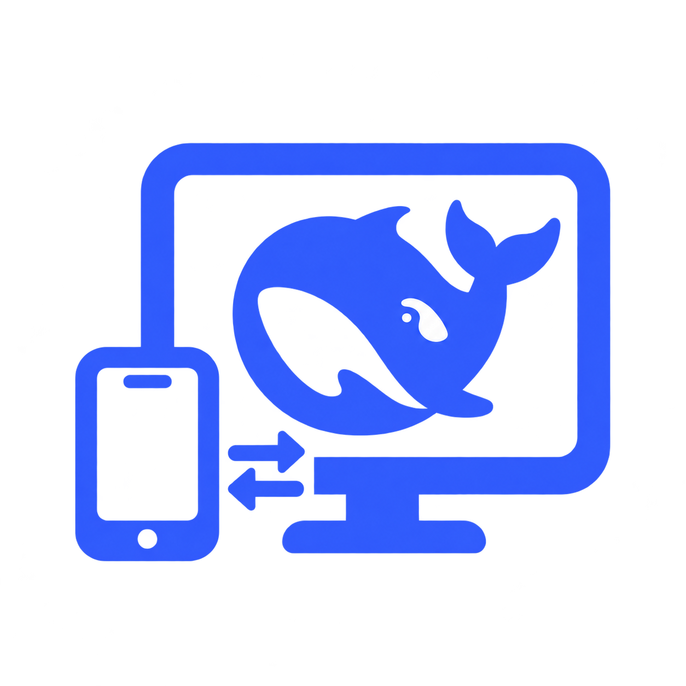
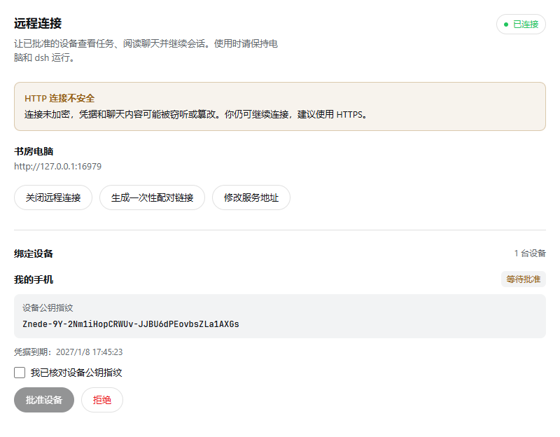
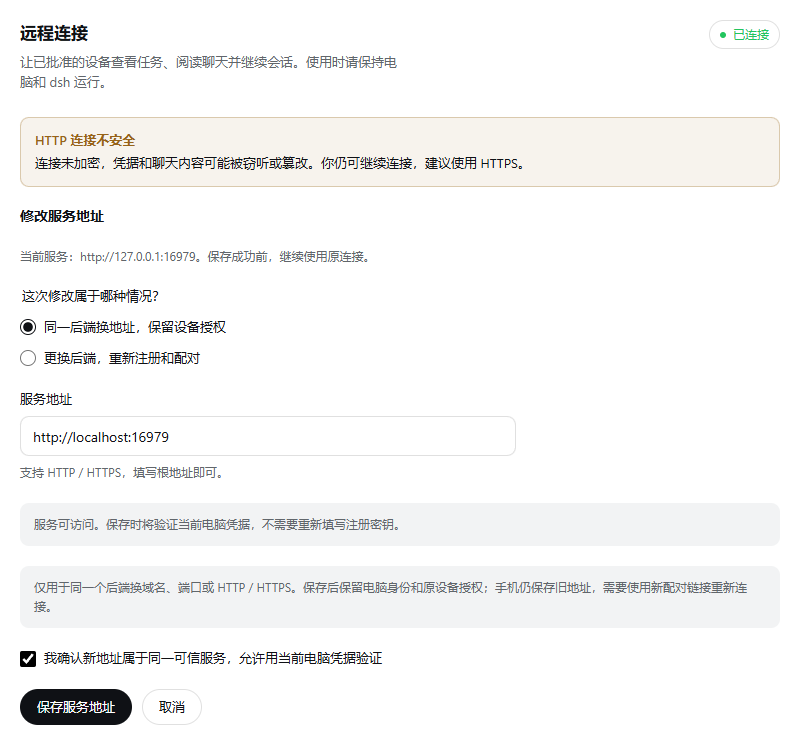

# DSHM Plugin for DeepSeek Harness

[简体中文](./README.md) | English

[DSHM Android app](https://github.com/KKUCODES/deepseek-harness-mobile/blob/main/README.en.md) · **DSHM desktop plugin** · [DSHM relay server](https://github.com/KKUCODES/dshm-relay/blob/main/README.en.md)

**DSHM Plugin** runs inside official [DeepSeek Harness (DSH)](https://github.com/deepseek-ai/deepseek-harness) on your computer, synchronizing workspaces, chat sessions, execution results, and approvals with the [DSHM Android client](https://github.com/KKUCODES/deepseek-harness-mobile/blob/main/README.en.md). Continue conversations and make decisions remotely while the computer executes tasks. No DSH core modifications or rebuilds are required.

[Install from GitHub](#install-the-plugin-and-pair-your-phone) · [Download the plugin](https://github.com/KKUCODES/dshm-plugin/releases/tag/v0.1.88-latest.0) · [Tested DSH version (JSON)](https://github.com/KKUCODES/dshm-plugin/releases/download/v0.1.88-latest.0/compatibility-0.2.2-rc.3.json) · [FAQ](#faq)

<p align="center">
  
</p>


## Remote sessions and device management

| Capability | What you can do |
| --- | --- |
| Conversation sync | View workspaces and history, create chats, send messages, switch models, and handle approvals. |
| Device management | Generate one-time pairing links valid for five minutes; verify fingerprints, approve, reject, or revoke devices. |
| Access control | Enable or disable remote connections. Computer management permission is granted and revoked separately. |
| Extensions | Forward files, tool results, and compatible plugin interface elements through permitted APIs. |



[Image sources (Chinese)](./docs/images/README.md). The real plugin interface uses demo devices and Simplified Chinese labels.

## Install the plugin and pair your phone

**For official DSH `0.2.2-rc.3`**, install the prebuilt plugin pinned to the `0.1.88-latest.0` release commit. From a DSH source checkout, prefix the command with `pnpm`.

```sh
dsh plugin --profile web add github:KKUCODES/dshm-plugin#5fb3f8e56ff3f839875d07e3cf2601754eea01d4
```

To install from a file, download the [plugin archive](https://github.com/KKUCODES/dshm-plugin/releases/download/v0.1.88-latest.0/dshm-plugin-0.1.88-latest.0-dsh-0.2.2-rc.3.tgz) and its [SHA-256 checksum](https://github.com/KKUCODES/dshm-plugin/releases/download/v0.1.88-latest.0/dshm-plugin-0.1.88-latest.0-dsh-0.2.2-rc.3.tgz.sha256). After verifying the checksum, pass the archive’s absolute path to DSH. Replace the example Windows path with yours.

```sh
dsh plugin --profile web add "C:/Downloads/dshm-plugin-0.1.88-latest.0-dsh-0.2.2-rc.3.tgz"
```

For Remote, install [DSHM preview.22 for Android](https://github.com/KKUCODES/deepseek-harness-mobile/releases/tag/v0.1.0-preview.22), then pair the phone with your computer. For a self-hosted relay, large responses require protocol commit `94183d0` or later. [Relay compatibility (Chinese)](./compatibility/latest-upstream/response-chunks.md)

1. Start DSH Web with `dsh web` (`pnpm dsh web` from a source checkout). If DSH is already running, restart it to load the plugin.
2. Enter the relay's root URL and computer name, register the computer, and enable the connection.
3. Claim the pairing link on your phone, then verify its fingerprint and approve it on the computer.
4. Open an existing workspace on your phone to continue a conversation or start a new chat.

**[Hosting your own relay](https://github.com/KKUCODES/dshm-relay/blob/main/README.en.md) is recommended.** Alternatively, enter the [public service](http://118.31.20.47:18787) URL: `http://118.31.20.47:18787`. Open registration requires no enrollment token; devices still need pairing and approval. No user account is needed.

The public service uses HTTP, so transport is unencrypted. Use a self-hosted HTTPS relay for sensitive content. Keep the computer and DSH running. [Full setup instructions (Chinese)](./docs/usage.md)

## Change the relay server address

In the plugin settings, select **“修改服务地址” (Change server address)**:

- **New address for the same backend:** Change the domain, port, or HTTP/HTTPS scheme. After verification, the computer identity and device permissions are retained.
- **Different backend:** Register and pair again. Private mode requires the new backend's enrollment token. Permissions on the old service are not automatically revoked.



Canceling or failed verification keeps the original connection. A successful save preserves whether the connection is enabled or disabled. The phone needs a new link to pair again. [Detailed steps (Chinese)](./docs/usage.md#5-修改服务地址)

## Current status

**0.1.88-latest.0** is a public prerelease for official DSH `0.2.2-rc.3`. The GitHub package and the release archive both passed installation and Web startup checks on that version. Remote runtime checks covered sending a message, receiving a model reply, approving or denying a tool request, and restoring history after reconnection. [Release notes (Chinese)](./ci/release-notes/0.1.88-latest.0.md) · [Installation checks](https://github.com/KKUCODES/dshm-plugin/actions/runs/44661018293)

The phone does not create computer workspaces, accept manually entered commands, or forward computer localhost websites.

## FAQ

### Which plugin package matches my DSH version?

Check the full DSH version on your computer. The only runtime-tested target for `0.1.88-latest.0` is `0.2.2-rc.3`. Earlier DSH versions have best-effort compatibility. If you use `0.2.0-rc.2`, `0.2.1-alpha.1`, `0.2.1-alpha.2`, or `0.2.1-rc.2`, the [previous 0.1.87 release](https://github.com/KKUCODES/dshm-plugin/releases/tag/v0.1.87-latest.0) has a separate archive for each. Match the full version in the filename. [Current compatibility manifest](https://github.com/KKUCODES/dshm-plugin/releases/download/v0.1.88-latest.0/compatibility-0.2.2-rc.3.json)

### Does claiming a pairing link immediately allow computer access?

The computer must first verify the phone's public-key fingerprint and approve it. Links expire after five minutes and can only be claimed once. Revoke approved devices from the computer's plugin settings; computer management permission is granted separately.

### Does continuing conversations require computer management permission?

No. Device approval allows chat and task operations. Managing computer workspaces, plugins, and settings requires separate management permission, which can also be revoked separately. See [access management (Chinese)](./docs/usage.md#4-管理访问).

## Development and documentation

The plugin uses TypeScript and Cordis with a React settings page. GitHub Actions builds against the pinned relay protocol and the SDK for DSH `0.2.2-rc.3`, then checks the committed GitHub package against source. `lib/` contains the compiled installation files. [Build workflow](./.github/workflows/plugin-build.yml)

```text
src/              Computer plugin, conversation adapter, and settings page
lib/              Committed GitHub install files, rebuilt and checked in CI
scripts/          Build and audit scripts
tests/            Plugin tests and fixtures
docs/             Usage, development, and technical documentation
compatibility/    Version support and compatibility evidence
```

Detailed guides are currently in Chinese:

- [Installation and usage](./docs/usage.md): connection, approval, and revocation.
- [Development guide](./docs/development.md): dependencies, builds, and versions.
- [Remote caching (Chinese)](./compatibility/latest-upstream/remote-cache.md): authoritative resource fingerprints and read-only deltas; pair with DSHM 0.1.0-preview.4. The existing relay needs no deployment.
- [Downloads and releases](./docs/releases.md): Actions packages and release drafts.
- [GitHub installation and market submission](./docs/github-install.md): official commands, pinned commits, and versions.
- [Support matrix](./compatibility/latest-upstream/official-support.md): validated and unvalidated scope.
- [Knowledge catalog](./docs/project-knowledge/catalog.md): architecture, interfaces, and validation evidence.

## License

Original code in this project is licensed under the [MIT License](./LICENSE). Third-party code, dependencies, and assets retain their respective licenses and terms of use.
