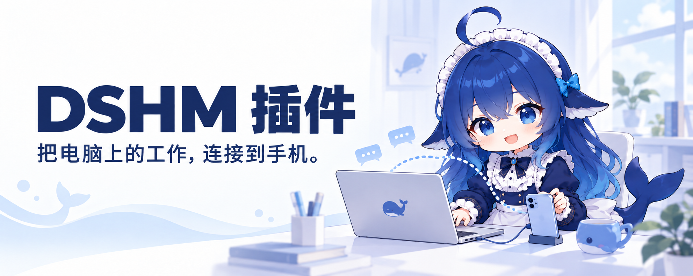
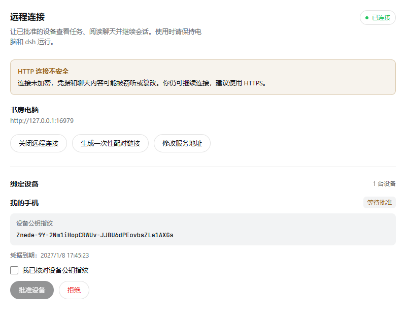
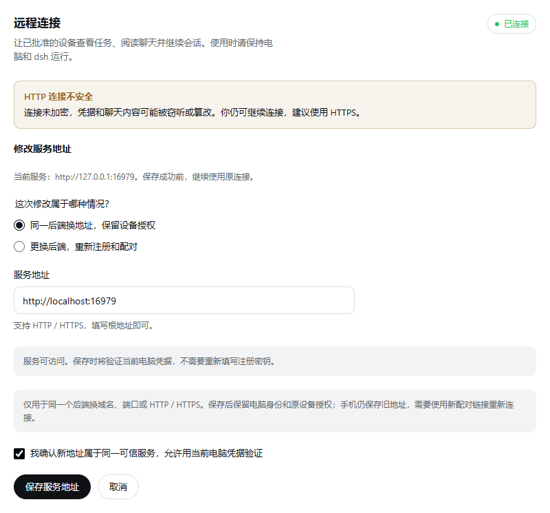

# DSHM Plugin

[简体中文](./README.md) | English

[Android app](https://github.com/KKUCODES/dshm/blob/main/README.en.md) · **Desktop plugin** · [Relay server](https://github.com/KKUCODES/dshm-relay/blob/main/README.en.md)

<p align="center">
  
</p>



A plugin for official DSH that connects computer conversations to the DSHM phone app. Follow progress, continue conversations, and handle approvals from your phone while the computer runs tasks. No DSH core modifications or rebuilds are required.

## Features

| Capability | What you can do |
| --- | --- |
| Conversation sync | View workspaces and history, create chats, send messages, switch models, and handle approvals. |
| Device management | Generate one-time pairing links valid for five minutes; verify fingerprints, approve, reject, or revoke devices. |
| Access control | Enable or disable remote connections. Computer management permission is granted and revoked separately. |
| Extensions | Forward files, tool results, and compatible plugin interface elements through permitted APIs. |



[Image sources (Chinese)](./docs/images/README.md). The real plugin interface uses demo devices and Simplified Chinese labels.

## Get started

[Plugin builds and downloads (Chinese)](./docs/releases.md) · [GitHub Actions](https://github.com/KKUCODES/dshm-plugin/actions/workflows/plugin-build.yml) · [Releases](https://github.com/KKUCODES/dshm-plugin/releases)

1. Install a plugin build matching your DSH version and run `pnpm dsh web`. Restart DSH if it says the plugin will load on the next start.
2. Enter the relay's root URL and computer name, register the computer, and enable the connection.
3. Claim the pairing link on your phone, then verify its fingerprint and approve it on the computer.
4. Open an existing workspace on your phone to continue a conversation or start a new chat.

**[Hosting your own relay](https://github.com/KKUCODES/dshm-relay/blob/main/README.en.md) is recommended.** Alternatively, enter the [public service](http://118.31.20.47:18787) URL: `http://118.31.20.47:18787`. Open registration requires no enrollment token; devices still need pairing and approval. No user account is needed.

The public service uses HTTP, so transport is unencrypted. Use a self-hosted HTTPS relay for sensitive content. Keep the computer and DSH running. [Full setup instructions (Chinese)](./docs/usage.md)

## Change the server address

In the plugin settings, select **“修改服务地址” (Change server address)**:

- **New address for the same backend:** Change the domain, port, or HTTP/HTTPS scheme. After verification, the computer identity and device permissions are retained.
- **Different backend:** Register and pair again. Private mode requires the new backend's enrollment token. Permissions on the old service are not automatically revoked.



Canceling or failed verification keeps the original connection. A successful save preserves whether the connection is enabled or disabled. The phone needs a new link to pair again. [Detailed steps (Chinese)](./docs/usage.md#5-修改服务地址)

## Current status

Candidate **`0.1.81-latest.0`** has separate builds for official DSH **`0.2.1-alpha.1` / `0.2.1-alpha.2`**; their archives are not interchangeable. Server address changes have [separate validation (Chinese)](./compatibility/latest-upstream/gateway-settings.md).

Core Remote validation used official DSH `0.2.1-alpha.2` + plugin `0.1.80-latest.0` + the matching Android app, locally in Web + MuMu. No official release yet. Electron, physical devices, the complete public-network path, and other versions, plugins, and models need separate validation. [Support matrix (Chinese)](./compatibility/latest-upstream/official-support.md)

The phone does not create computer workspaces, accept manually entered commands, or forward computer localhost websites.

## Development and documentation

TypeScript + Cordis, with a React settings page. GitHub Actions prepares the pinned backend protocol and published SDK packages, building separate archives for the two DSH versions. The default local build still targets the older baseline. See the [automated build guide (Chinese)](./docs/releases.md) and development guide.

```text
src/              Computer plugin, conversation adapter, and settings page
scripts/          Build and audit scripts
tests/            Plugin tests and fixtures
docs/             Usage, development, and technical documentation
compatibility/    Version support and compatibility evidence
```

Detailed guides are currently in Chinese:

- [Installation and usage](./docs/usage.md): connection, approval, and revocation.
- [Development guide](./docs/development.md): dependencies, builds, and versions.
- [Downloads and releases](./docs/releases.md): Actions packages and release drafts.
- [Support matrix](./compatibility/latest-upstream/official-support.md): validated and unvalidated scope.
- [Knowledge catalog](./docs/project-knowledge/catalog.md): architecture, interfaces, and validation evidence.
