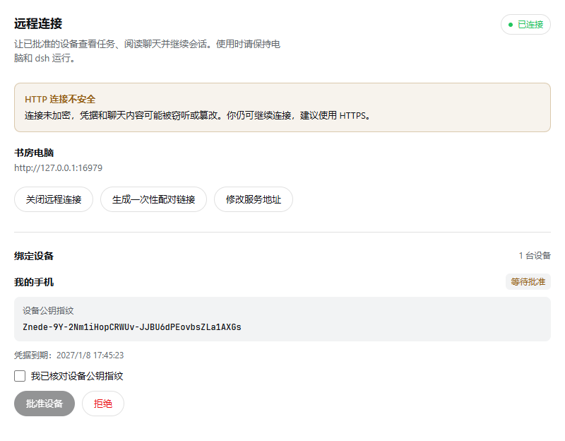
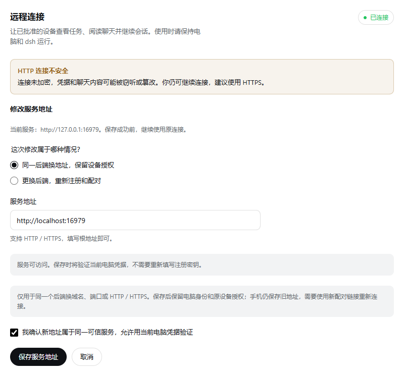

# DSHM 插件 · DeepSeek Harness 远程连接

简体中文 | [English](./README.en.md)

[DSHM 安卓客户端](https://github.com/KKUCODES/deepseek-harness-mobile) · **DSHM 电脑插件** · [DSHM 中转服务](https://github.com/KKUCODES/dshm-relay)

**DSHM 插件**安装在电脑的官方 [DeepSeek Harness（DSH）](https://github.com/deepseek-ai/deepseek-harness) 中，将工作区、聊天会话、执行结果和审批同步到 [DSHM 安卓客户端](https://github.com/KKUCODES/deepseek-harness-mobile)。手机远程续聊与决策，电脑执行任务；无需修改或重建 DSH。

[GitHub 一条命令安装](#安装插件并配对手机) · [下载插件包](https://github.com/KKUCODES/dshm-plugin/releases/tag/v0.1.88-latest.0) · [已验 DSH 版本（JSON）](https://github.com/KKUCODES/dshm-plugin/releases/download/v0.1.88-latest.0/compatibility-0.2.2-rc.3.json) · [常见问题](#常见问题)

<p align="center">
  
</p>


## 远程会话与设备管理功能

| 能力 | 内容 |
| --- | --- |
| 会话同步 | 查看工作区与历史、创建聊天、发送消息、切换模型、处理审批。 |
| 设备管理 | 五分钟有效的一次性配对链接；核对指纹、批准、拒绝与撤销。 |
| 访问控制 | 开关远程连接；电脑管理权限另行授予或收回。 |
| 扩展 | 通过允许的接口转发文件、工具结果与兼容插件局部界面。 |



[图片来源](./docs/images/README.md)。真实插件页面，使用演示设备。

## 安装插件并配对手机

**电脑使用官方 DSH `0.2.2-rc.3` 时**，可用以下命令安装预编译插件。命令已固定到 `0.1.88-latest.0` 的发行提交。从 DSH 源码目录运行时，在命令前加 `pnpm`。

```sh
dsh plugin --profile web add github:KKUCODES/dshm-plugin#5fb3f8e56ff3f839875d07e3cf2601754eea01d4
```

也可以下载[插件包](https://github.com/KKUCODES/dshm-plugin/releases/download/v0.1.88-latest.0/dshm-plugin-0.1.88-latest.0-dsh-0.2.2-rc.3.tgz)和 [SHA-256 校验文件](https://github.com/KKUCODES/dshm-plugin/releases/download/v0.1.88-latest.0/dshm-plugin-0.1.88-latest.0-dsh-0.2.2-rc.3.tgz.sha256)。核对后，用插件包的绝对路径安装。以下是 Windows 示例，请换成实际下载路径。

```sh
dsh plugin --profile web add "C:/Downloads/dshm-plugin-0.1.88-latest.0-dsh-0.2.2-rc.3.tgz"
```

在手机上安装 [DSHM preview.22 安卓客户端](https://github.com/KKUCODES/deepseek-harness-mobile/releases/tag/v0.1.0-preview.22) 后，按下方步骤配对。自建中转需包含协议提交 `94183d0` 或后续版本才能传输大响应。[中转兼容说明](./compatibility/latest-upstream/response-chunks.md)

1. 执行 `dsh web` 启动 DSH Web（源码目录使用 `pnpm dsh web`）。若 DSH 已在运行，重启后加载插件。
2. 填写中转根地址、电脑名称，注册电脑并开启连接。
3. 手机领取配对链接，电脑核对指纹并批准。
4. 手机打开已有工作区，继续会话或创建新聊天。

**推荐[自建中转](https://github.com/KKUCODES/dshm-relay)**；也可填[公共服务](http://118.31.20.47:18787) `http://118.31.20.47:18787`。开放注册免密，设备仍需配对与批准，无需用户账号。

公共服务使用 HTTP，传输未加密。敏感内容建议自建 HTTPS。电脑和 DSH 必须保持运行。[完整安装步骤](./docs/usage.md)

## 更换中转服务地址

点击插件设置页 **“修改服务地址”**：

- **同一后端换地址：** 换域名、端口或 HTTPS，验证后保留电脑身份和授权。
- **更换后端：** 重新注册和配对；个人模式需新密钥，旧服务授权不会自动撤销。



取消或验证失败保留原连接，保存成功保留启停状态。手机需新链接重新配对。[详细步骤](./docs/usage.md#5-修改服务地址)

## 当前状态

**0.1.88-latest.0** 为公开预发布版。GitHub 安装包与发行归档均通过官方 DSH `0.2.2-rc.3` 的安装和 Web 启动检查。Remote 运行验收覆盖发送消息、接收模型回复、允许或拒绝工具请求，以及重连后恢复历史。[发行说明](./ci/release-notes/0.1.88-latest.0.md) · [安装检查](https://github.com/KKUCODES/dshm-plugin/actions/runs/44661018293)

手机不创建电脑工作区、不输入命令、不转发电脑 localhost 网站。

## 常见问题

### 应该选择哪个 DSH 版本的插件包？

先核对电脑上的 DSH 完整版本。`0.1.88-latest.0` 仅对 `0.2.2-rc.3` 做过运行回归，旧版为尽力兼容。如果使用 `0.2.0-rc.2`、`0.2.1-alpha.1`、`0.2.1-alpha.2` 或 `0.2.1-rc.2`，[历史版本 0.1.87](https://github.com/KKUCODES/dshm-plugin/releases/tag/v0.1.87-latest.0) 提供各自的归档，可按文件名中的完整版本选择。[本版兼容清单](https://github.com/KKUCODES/dshm-plugin/releases/download/v0.1.88-latest.0/compatibility-0.2.2-rc.3.json)

### 配对链接发给手机后就能访问电脑吗？

还需要电脑核对手机的公钥指纹并批准。链接五分钟内有效，领取后失效；已批准设备可以在电脑插件页撤销，电脑管理权限另行授予。

### 手机续聊必须获得电脑管理权限吗？

不需要。批准设备后即可使用聊天与任务操作；管理电脑工作区、插件和设置需要另行授予管理权限，也可以单独收回。操作入口见[管理访问](./docs/usage.md#4-管理访问)。

## 开发与文档

插件使用 TypeScript 和 Cordis，配置页使用 React。GitHub Actions 使用固定版本的中转协议与 DSH `0.2.2-rc.3` SDK 构建，并核对仓库中预编译的安装产物与源码一致。安装入口位于 `lib/`。[构建流程](./.github/workflows/plugin-build.yml)

```text
src/              电脑插件、会话适配与配置页
lib/              已编译 GitHub 安装入口，随源码提交并由 CI 复核
scripts/          构建与审查脚本
tests/            插件测试与夹具
docs/             使用、开发和技术文档
compatibility/    版本支持与兼容验证资料
```

- [安装与使用](./docs/usage.md)：连接、批准与撤销。
- [开发指南](./docs/development.md)：依赖、构建与版本。
- [Remote 缓存](./compatibility/latest-upstream/remote-cache.md)：权威资源指纹与只读数据差量，需配套 DSHM 0.1.0-preview.4，现有中转无需升级。
- [下载与发版](./docs/releases.md)：Actions 插件包与发行草稿。
- [GitHub 安装与市场投稿](./docs/github-install.md)：官方命令、固定提交及版本要求。
- [支持清单](./compatibility/latest-upstream/official-support.md)：已验与未验范围。
- [知识库](./docs/project-knowledge/catalog.md)：架构、接口与验证资料。

## 许可证

本项目原创代码采用 [MIT 许可证](./LICENSE)。第三方代码、依赖和素材遵循各自的许可证与使用条件。
